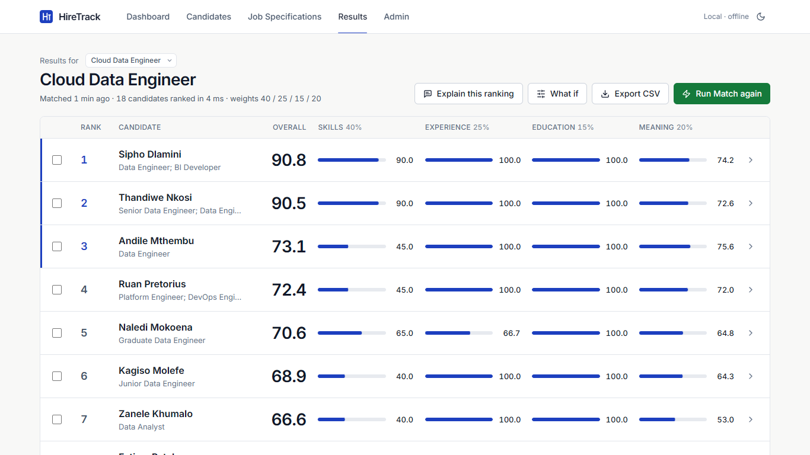
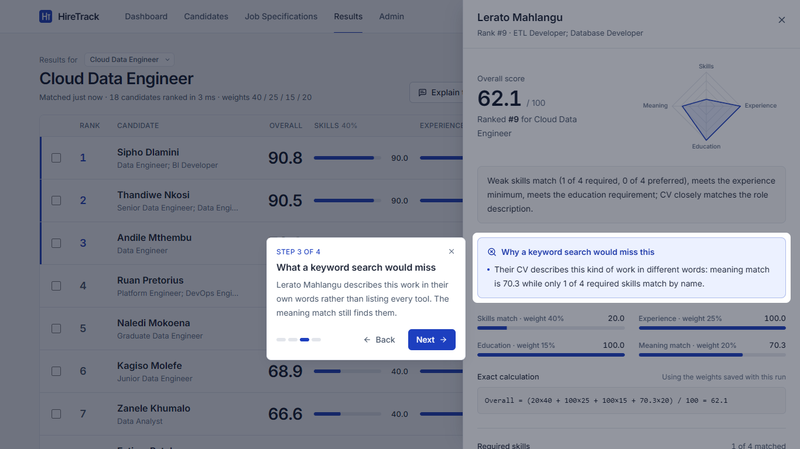
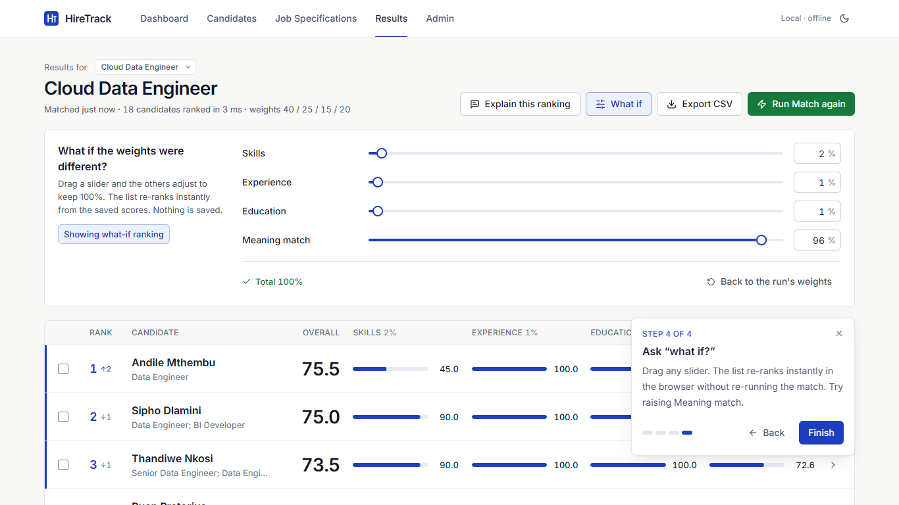

# HireTrack: candidate-job matching engine

HireTrack is a local, offline web app for recruiters. You manage candidates, write a job specification with adjustable scoring weights, run the matching engine, and get a ranked shortlist where every score can be explained, down to the exact calculation.



| Keyword search vs meaning | Live "what if" re-ranking |
|---|---|
|  |  |

---

## Quick start (one command)

You need **Python 3.11** and **Node.js 18+** (only for the first build). Internet is needed once, to install packages and download the model. After that the app runs fully offline.

**Windows**

```bat
start-windows.bat
```

**macOS / Linux**

```bash
chmod +x start-mac.sh
./start-mac.sh
```

The first run creates `.venv`, installs the Python packages, downloads the language model (about 90 MB), builds the frontend and asks you to choose an admin passcode. Later runs start in a few seconds. The app opens at **http://127.0.0.1:8000**.

---

## Manual install and run (exact steps)

From the project root:

```bash
# 1. Python environment (Python 3.11)
python3.11 -m venv .venv              # Windows: py -3.11 -m venv .venv
source .venv/bin/activate             # Windows: .venv\Scripts\activate
pip install -r backend/requirements.txt

# 2. Download the model once (needs internet; saved to ./models)
cd backend
python -m app.download_model

# 3. Set the admin passcode (stores only a bcrypt hash in ../.env)
python -m app.hash_passcode "choose-a-passcode" --write
cd ..

# 4. Build the frontend
cd frontend
npm install
npm run build
cd ..

# 5. Run (one port: API + built frontend)
cd backend
HF_HUB_OFFLINE=1 uvicorn app.main:app --host 127.0.0.1 --port 8000
#   Windows PowerShell:  $env:HF_HUB_OFFLINE=1; uvicorn app.main:app --host 127.0.0.1 --port 8000
```

Then open http://127.0.0.1:8000. `HF_HUB_OFFLINE=1` is also set by default in `app/config.py`, so the app never contacts the internet at runtime.

### Development mode (hot reload)

```bash
# terminal 1
cd backend && uvicorn app.main:app --host 127.0.0.1 --port 8000 --reload
# terminal 2
cd frontend && npm run dev        # http://127.0.0.1:5173, proxies /api to :8000
```

---

## Running the 3-minute demo

1. Open the **Dashboard** and press **Start guided demo**. Nothing needs typing.
2. If the database is empty, the demo data loads (18 candidates, 3 jobs). The Cloud Data Engineer specification opens pre-filled and the match runs by itself.
3. The ranked list animates in, then a 4-step tour walks through:
   1. **The ranked shortlist**: rank, overall score and the four score bars, with the top three marked.
   2. **The breakdown** of the top candidate: matched and missing skills, a plain-English summary, the exact calculation and a radar chart.
   3. **What a keyword search would miss**: Lerato Mahlangu lists almost none of the required tools but describes exactly this work, and the meaning match finds her.
   4. **"What if?"**: drag the sliders and watch the list re-rank instantly.
4. Optional extras: tick 2 or 3 candidates and press **Compare head to head**; press **Explain this ranking** for a sentence under every row; press **Export CSV**.

To show scale, go to **Admin**, unlock with the passcode and choose **Load 2,000 candidates**.

---

## How a match is scored

All scoring lives in [`backend/app/engine/scoring.py`](backend/app/engine/scoring.py). It is pure Python, has no database code and is fully unit tested.

| Part | Rule |
|---|---|
| Skills | (required matched / required) × 80 + (preferred matched / preferred) × 20. With no preferred skills, required skills count for the full 100. |
| Experience | 100 if years ≥ minimum (or the minimum is 0), otherwise years / minimum × 100 |
| Education | 100 if level ≥ minimum level, otherwise level / minimum × 100 (Matric = 1 … Doctorate = 7) |
| Meaning (semantic) | Cosine similarity between the CV summary and the job description embeddings (all-MiniLM-L6-v2), negatives set to 0, × 100 |
| **Overall** | (skills × w_skills + experience × w_experience + education × w_education + semantic × w_semantic) / 100 |

- Every part is rounded to 1 decimal (half up) before the overall score is calculated, so the formula shown on screen reproduces exactly, e.g. `Overall = (90×40 + 100×25 + 100×15 + 74.2×20) / 100 = 90.8`.
- **Ranking:** overall descending, then skills descending, then name A–Z (then id, for full determinism).
- **Skill normalisation:** lowercase, trim, collapse spaces, remove duplicates, plus about 90 aliases (`js` → javascript, `ts` → typescript, `py` → python, `k8s` → kubernetes, `postgres` → postgresql, `ml` → machine learning, `node` → node.js, `pbi` → power bi, `sklearn` → scikit-learn and so on). See [`engine/skills.py`](backend/app/engine/skills.py).
- **Fairness:** scoring reads only skills, years, education level and the CV summary. Name, email, age, gender and race are never inputs. The name is used only as the final alphabetical tie-break.
- The **plain-English explanation** and the **"Why a keyword search would miss this"** notes are generated from the scores in the same module. The callout appears when the meaning score is at least 60 while the skills score is below 60, or when a skill matched through an alias (for example "Py" matched Python).

### Performance

Measured on the development laptop (16-thread CPU, no GPU) with the real model:

| Scenario | Time |
|---|---|
| Match 50 candidates, nothing cached | 0.55 s |
| Match 2,018 candidates, embeddings cached | 0.6–0.9 s |
| Load the 2,018 results on the Results page | 0.3 s |
| One-off encoding of 2,018 new CVs (runs in the background after loading) | about 17 s |

Embeddings are batch-encoded and cached in memory and on disk (`data/embedding_cache.npz`, keyed by SHA-1 of the text, so no CV text is written there). Each CV is encoded only once, even across restarts. The job description is encoded once per run. After **Load 2,000 candidates** the app starts encoding in the background immediately. If you press Run Match before that has finished, the button explains the one-off wait.

---

## Project layout

```
backend/
  app/
    main.py            FastAPI app, error handlers, CORS, serves frontend/dist
    config.py          paths and settings (.env)
    database.py        SQLite engine; PRAGMA foreign_keys=ON on every connection
    models.py          SQLAlchemy models with CHECK constraints
    schemas.py         Pydantic request/response models and validation
    security.py        bcrypt passcode check (X-Admin-Passcode header)
    download_model.py  one-off model download
    hash_passcode.py   create the bcrypt hash for .env
    engine/            scoring.py, embeddings.py, skills.py (no DB code)
    routers/           candidates, jobs, match, admin
    services/          candidate, job, match, backup, seed
  seed/
    dummy_candidates.json      18 candidates + 3 jobs (all fictitious)
    generate_large_dataset.py  ~2,000 reproducible fictitious IT candidates
  tests/               test_scoring.py, test_api.py, test_performance.py
frontend/
  src/pages            Dashboard, Candidates, Jobs, Results, Admin
  src/components       MetricBar, WeightSliders, TagInput, RadarChart, Tour, ...
  src/lib              scoring.js (client-side re-rank), validation.js, format.js
  src/apiClient.js
  e2e/                 Playwright screenshot and recorded-demo scripts
data/ backups/ logs/ models/   (created at runtime, gitignored)
```

## API

All errors use the shape `{"detail": "...", "field": "..."}`.

| Method | Path | Notes |
|---|---|---|
| GET / POST | `/api/candidates` | GET supports `?search=`, `page`, `page_size` (max 5000), `sort` (name, years, level, created), `order` |
| GET / PUT / DELETE | `/api/candidates/{id}` | |
| GET / POST | `/api/jobs` | |
| GET / PUT / DELETE | `/api/jobs/{id}` | |
| POST | `/api/jobs/{id}/match` | runs the engine; saves all results in one transaction |
| GET | `/api/jobs/{id}/results` | latest run with results, weights used and run time |
| GET | `/api/jobs/{id}/results.csv` | CSV export (formula-injection safe) |
| GET | `/api/education-levels` | |
| GET | `/api/stats` | dashboard tiles |
| POST | `/api/demo/start` | guided demo; seeds only if the database is empty |
| POST | `/api/admin/verify` | passcode check |
| POST | `/api/admin/seed` | reset to demo data (safety backup first) |
| POST | `/api/admin/seed-large` | demo data + ~2,000 generated candidates |
| GET / POST | `/api/admin/backups` | list / back up now |
| POST | `/api/admin/backups/{file}/restore` | integrity check, safety backup, restore |

Admin endpoints need the passcode in the `X-Admin-Passcode` header. Interactive docs are at http://127.0.0.1:8000/docs.

## Security and backups

- Binds to 127.0.0.1 only. CORS allows only `http://127.0.0.1:8000` and the Vite dev address.
- SQLAlchemy bound parameters only. There is no string-built SQL.
- The admin passcode is stored only as a bcrypt hash in `.env` (never committed; see `.env.example`). The Admin screen keeps the passcode in memory only, and restore asks for it again.
- Logging goes to `logs/app.log`, rotating at 1 MB × 5 files. Only ids and counts are logged, never CV text.
- Backups use SQLite's online backup API and are kept in `backups/`:
  - automatically once per day at start-up
  - automatically before every seed and every restore
  - manually from Admin
- Only the 10 most recent backups are kept. `PRAGMA integrity_check` runs before any restore, and a corrupt file is refused.
- The frontend never uses `dangerouslySetInnerHTML`.

## Tests

```bash
cd backend
python -m pytest                                       # 123 tests: engine, API, perf (fast embedder)
HIRETRACK_REAL_MODEL=1 python -m pytest tests/test_performance.py -s   # time with the real model

cd ../frontend
npm test                                               # Vitest: MetricBar, WeightSliders, TagInput, re-ranking, validation

# with the app running on :8000 (uses your installed Edge or Chrome):
node e2e/screens.mjs ../docs/screenshots               # every screen at 1366x768 and 1920x1080
node e2e/demo-flow.mjs ../docs/evidence                # records the guided demo and checks it
```

See [docs/test_report.md](docs/test_report.md) for the latest results.

---

## Decisions and deviations

Decisions I made where the brief left room, so you can review them:

1. **Two schema additions.**
   - A `match_run` table stores each run's duration and the weights actually used, so the Results screen stays truthful if the job is edited later.
   - `match_result` also stores the explanation sentence and keyword notes as they were at run time.
   - `candidate_skill.entered_as` keeps what was typed (for example "JS"), so "JS was read as JavaScript" can be shown. It depends on the full key, so the schema is still 3NF.
   - Everything else follows the brief's tables and CHECK constraints exactly.
2. **The guided demo needs no passcode.** `POST /api/demo/start` loads demo data only when the database is empty, so it can't destroy anything. Every destructive action stays behind the passcode.
3. **"What if" sliders auto-balance.** On the Results screen, moving one weight spreads the difference across the others in proportion, so the total stays at 100% and the list can re-rank on every drag. On the job form the weights are independent, and Run Match stays disabled until they total exactly 100%, as specified.
4. **Labels.** "Semantic" appears as **Meaning** or **Meaning match** on screen to avoid jargon.
5. **Candidates table** loads all candidates once and searches and sorts in the browser. The list is virtualised, so 2,000 rows stay smooth. The API still supports `?search=` and pagination.
6. **Results** shows the top 50 rows with "Show more", so the re-rank animation stays smooth with 2,000 candidates. CSV export always contains everyone.
7. **Average match score** on the Dashboard is the average overall score of the most recent run.
8. **Large dataset** replaces the current data with the 18 demo candidates plus 2,000 generated ones and the 3 demo jobs, with a safety backup first.
9. **Fallback embedder.** If the model folder is missing, the app still runs with a deterministic word-hashing embedder and logs a warning. `/api/stats` reports which embedder is active. Fast unit tests use the fallback; the performance test can use the real model.
10. **Pinned `bcrypt==4.0.1`**, because passlib 1.7.4 is incompatible with newer bcrypt releases.
11. **Dark theme** is included (moon icon, top right). The choice is remembered per browser.
12. **Seed data tuning.** The demo candidates were tuned against the real model so the story is clear: strong fits, partial fits, poor fits, one alias hit (Sipho lists "Py"), and two candidates whose wording rather than tool list earns them a high meaning score (Lerato Mahlangu and Kagiso Molefe).

## Troubleshooting

- **"Semantic model unavailable" in the log:** run `python -m app.download_model` inside `backend/` while online.
- **"Admin passcode is not set up":** run `python -m app.hash_passcode "<passcode>" --write` inside `backend/`, then restart.
- **Port 8000 busy:** stop the other process, or run uvicorn with `--port 8001`. The built frontend works on any port. For dev mode, keep 8000, because Vite proxies to it.
- **Frontend changes not showing on :8000:** run `npm run build` again and restart uvicorn.
