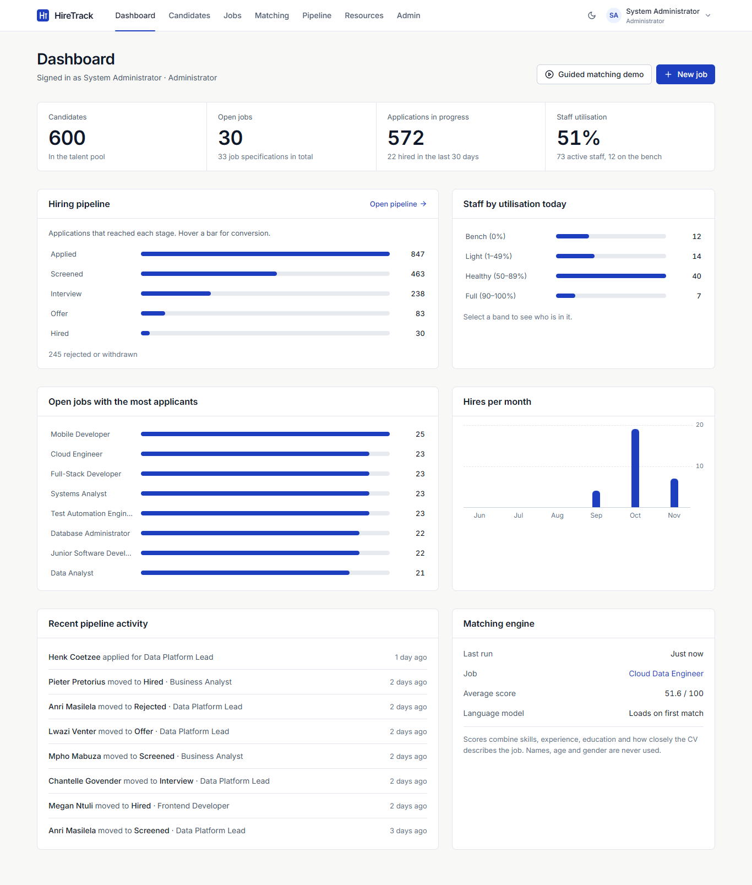

# HireTrack: Applicant Tracking and Resource Allocation System

Richfield IT Project (Year 3), Semester 2 2026. Phase 5 Implementation. Group: Rohan Naik (402311822), Nadhir Mahomed (402110343), Joshua S Pillay (402200878), Sheik Kader (402413277), Tiara Govender (402306095), Rudo Fourie (402410352).
Repository: https://github.com/RohanRajaramNaik/hiretrack
Installation guide: [INSTALLATION_GUIDE.md](INSTALLATION_GUIDE.md). Phase 5 report: [docs/report/](docs/report/).

HireTrack runs on one computer. Recruiters capture candidates and job specifications, rank every candidate against a job with an explainable matching engine, and move applicants through a hiring pipeline. Resource managers then allocate hired and existing staff to client projects and see who is booked and who is on the bench.



## Features

| Area | What it does |
|---|---|
| Accounts | Sign-in for three roles (Administrator, Recruiter (HR), Resource Manager). Passwords hashed with bcrypt, signed JWT sessions, role checks on every API route, lock-out after 5 failed attempts. |
| Candidates | Add, edit, search, delete. Fill the form from a PDF, Word or text CV. Bulk import from CSV or Excel with a per-row error report. |
| Job specifications | Title, location, open/closed status, required and preferred skills, minimum experience and education, description, and four scoring weights that must total 100%. |
| Matching engine | Ranks every candidate: skills overlap, experience, education and meaning (cosine similarity of all-MiniLM-L6-v2 embeddings, run locally). Every score has a breakdown and the exact calculation. "What if" weights, head-to-head compare, CSV export. |
| Pipeline | Applied, Screened, Interview, Offer, Hired or Rejected. One stage forward at a time, reject from any open stage, reopen a rejection. Full audit history with user, time and note. |
| Resource allocation | Staff pool (existing staff plus everyone hired), client projects, allocations by percentage and dates. Nobody can be booked above 100% on any day. Utilisation and bench view. |
| Dashboard | Key counts, pipeline funnel, applicants per job, staff utilisation, hires per month, recent activity. |
| Administration | User accounts, three seed datasets, backups and integrity-checked restore. |

## Quick start

Python 3.11 and Node.js 18+ are needed. From this folder:

```
start.bat            # Windows
./start.sh           # macOS / Linux (chmod +x start.sh first)
```

The first run installs everything, downloads the model, builds the screens and seeds the database, then opens http://127.0.0.1:8000. Full steps, options and troubleshooting: [INSTALLATION_GUIDE.md](INSTALLATION_GUIDE.md).

| Role | Email | Password |
|---|---|---|
| Administrator | admin@hiretrack.local | Admin@123 |
| Recruiter (HR) | recruiter@hiretrack.local | Recruiter@123 |
| Resource Manager | manager@hiretrack.local | Manager@123 |

## Technology

| Layer | Technology |
|---|---|
| Frontend | React 18, Vite 5, Tailwind CSS 3, React Router, lucide icons |
| Backend | Python 3.11, FastAPI, Pydantic 2, SQLAlchemy 2, Uvicorn |
| Database | SQLite (one file), foreign keys and CHECK constraints enforced |
| Matching | sentence-transformers all-MiniLM-L6-v2 (local, no paid API), NumPy |
| Security | passlib/bcrypt, PyJWT |
| Import | openpyxl (Excel), pypdf (PDF CVs) |
| Testing | pytest + pytest-cov, Vitest + React Testing Library, Playwright |

## Project layout

```
backend/
  app/
    main.py              FastAPI app, error handling, serves frontend/dist
    security.py          passwords, JWT, require_roles(), lock-out
    models.py            14 SQLAlchemy tables with CHECK/UNIQUE/FK rules
    schemas.py           Pydantic validation for every request
    engine/              pure rules, no database code:
                         scoring.py, embeddings.py, skills.py, pipeline.py, allocation.py
    routers/             auth, candidates, jobs, match, pipeline, resources, admin
    services/            user, candidate, import, job, match, pipeline, resource,
                         dashboard, seed, backup
    download_model.py    one-off model download
    reset_password.py    command-line password reset
  tests/unit/            scoring, pipeline rules, allocation rules, database constraints
  tests/integration/     API, auth and roles, pipeline, resources, import, seed, performance
frontend/
  src/pages/             Login, Dashboard, Candidates, Jobs, Results (Matching), Pipeline,
                         Resources, Admin, ImportPanel
  src/components/        Charts, MetricBar, WeightSliders, TagInput, RadarChart, Overlay, ...
  src/lib/               auth, validation, scoring (what-if), stages, format
  src/test/              Vitest component and logic tests
  e2e/tests/             Playwright journeys (TC-01 to TC-22)
seed/
  seed_database.py       creates the database with realistic fictitious data
  catalogue.py           30 job specifications, 12 client projects, staff roles
  generate_large_dataset.py, dummy_candidates.json
start.bat, start.sh      one-command install and start
```

## Tests

| Suite | Count | Result |
|---|---|---|
| Backend unit (pytest) | 133 | all pass |
| Backend integration (pytest, FastAPI TestClient) | 197 | all pass |
| Frontend component (Vitest + Testing Library) | 49 | all pass |
| End-to-end journeys (Playwright, Edge and Chrome) | 22 | all pass |
| Backend line coverage | 95% | target 70% |

Commands are in section 7 of the installation guide.

## Security notes

- The server listens on 127.0.0.1 only. CORS allows only the local addresses.
- All SQL uses bound parameters through SQLAlchemy.
- Loading a dataset or restoring a backup needs the administrator's password again.
- Logs record ids and counts only, never CV text. All seed data is fictitious.
